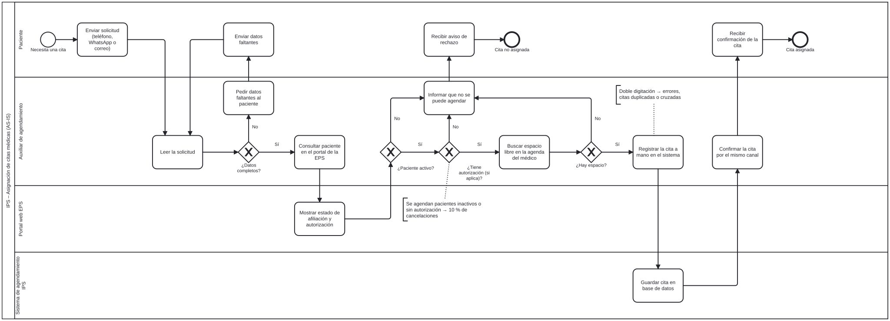
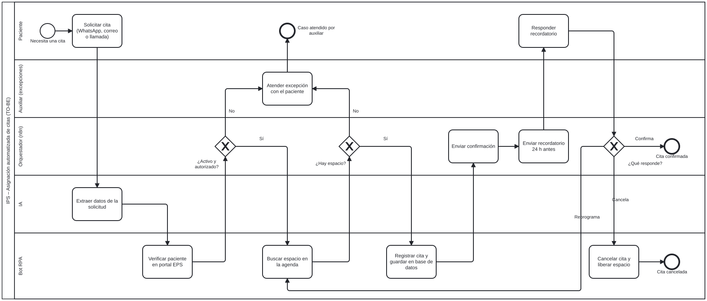

# Modelos BPMN (AS-IS y TO-BE) – Agendamiento de citas IPS

Modelos BPMN 2.0 del proceso actual (**AS-IS**) y del proceso automatizado (**TO-BE**) para la asignación de citas médicas de consulta externa en la IPS, diagramados en **bpmn.io (`bpmn-js 18.31.0`)**.

## Archivos de esta carpeta

| Archivo | Formato | Descripción |
|---|---|---|
| [agendamiento-citas-asis.bpmn](agendamiento-citas-asis.bpmn) | BPMN 2.0 XML | Modelo editable del proceso manual actual (AS-IS). |
| [asis.svg](asis.svg) | SVG | Diagrama exportado del proceso AS-IS. |
| [agendamiento-citas-tobe.bpmn](agendamiento-citas-tobe.bpmn) | BPMN 2.0 XML | Modelo editable del proceso automatizado propuesto (TO-BE). |
| [tobe.svg](tobe.svg) | SVG | Diagrama exportado del proceso TO-BE. |

> Para inspeccionar o editar cualquiera de los archivos `.bpmn`, ábrelos en [demo.bpmn.io](https://demo.bpmn.io) o en **Camunda Modeler**.

---

## Proceso actual (AS-IS)

### Carriles (*lanes*) y operación manual

| Carril | Responsabilidad actual | Cuellos de botella identificados |
|---|---|---|
| **Paciente** | Envía la solicitud por teléfono, WhatsApp o correo; reenvía datos cuando están incompletos y recibe confirmación o rechazo. | Espera de 1 a 2 días por respuesta; sin recordatorio previo (**20 % de inasistencia**). |
| **Auxiliar de agendamiento** | Lee cada mensaje, pide datos faltantes, entra al portal EPS, verifica afiliación/autorización, busca agenda, digita la cita y confirma. | **8 min por solicitud** × 300 solicitudes/día = **40 h/día** de carga frente a 32 h disponibles con 4 auxiliares (**97 % de ocupación**). |
| **Portal web EPS** | Muestra en pantalla el estado de afiliación y las autorizaciones vigentes (no cuenta con API). | Omisiones humanas en la validación generan **10 % de citas canceladas** por pacientes inactivos o sin orden vigente. |
| **Sistema de agendamiento IPS** | Almacena la reserva ingresada manualmente por el auxiliar. | **Doble digitación** manual entre canales, portal EPS y agenda provoca errores, citas duplicadas o cruzadas. |

---

## Proceso propuesto (TO-BE)

### Rediseño y distribución de responsabilidades

| Carril | Rol en el proceso TO-BE | Mejora obtenida |
|---|---|---|
| **Paciente** | Solicita la cita por su canal habitual y responde al recordatorio automático 24 h antes (`Confirma`, `Cancela` o `Reprograma`). | Respuesta en minutos y posibilidad de liberar o mover el cupo oportunamente. |
| **IA** | Extrae de forma estructurada documento, nombre, EPS, especialidad y nivel de urgencia desde texto libre ([RF-02](../04-requerimientos/README.md)). | Elimina la lectura manual y el reproceso de transcripción inicial. |
| **Bot RPA** | Verifica al paciente en el portal EPS, busca cupo priorizando urgencias, registra la cita sin doble digitación y cancela/libera espacios ([RF-03 a RF-05, RF-08](../04-requerimientos/README.md)). | Cero modificaciones sobre los sistemas actuales sin API y validación sistemática de afiliación y autorizaciones. |
| **Orquestador (n8n)** | Evalúa las compuertas de negocio, envía confirmación inmediata, programa el recordatorio 24 h antes y enruta la respuesta del paciente ([07-solucion](../07-solucion/README.md)). | Trazabilidad punta a punta y ejecución continua durante todo el horario de atención. |
| **Auxiliar (excepciones)** | Atiende únicamente los casos escalados (paciente inactivo, sin autorización, sin cupos o falla técnica). | La ocupación de los auxiliares baja de **97 % a 27 %**, enfocando al equipo humano en casos que requieren acompañamiento. |
