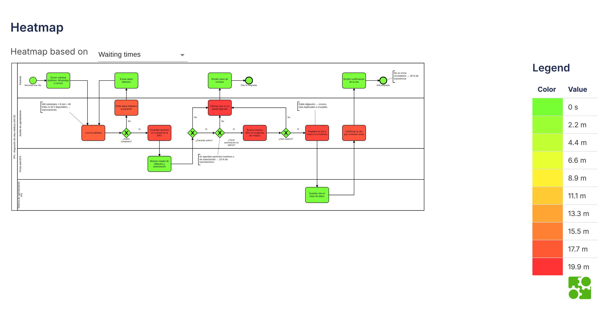
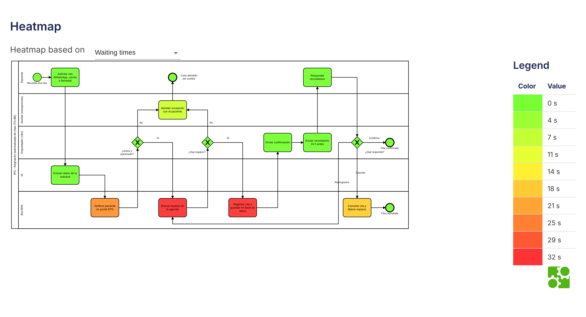

# Simulación de procesos (BIMP) – Agendamiento de citas IPS

Resultados cuantitativos de la simulación en **BIMP** sobre **300 solicitudes de cita** comparando el [modelo AS-IS](../01-bpmn/agendamiento-citas-asis.bpmn) frente al [modelo TO-BE](../01-bpmn/agendamiento-citas-tobe.bpmn).

## Archivos de esta carpeta

| Archivo | Descripción |
|---|---|
| [simulation_results-as-is.csv](simulation_results-as-is.csv) | Estadísticas detalladas de utilización, tareas, distribuciones y las 300 instancias del escenario AS-IS. |
| [simulation_results-tobe.csv](simulation_results-tobe.csv) | Estadísticas detalladas de utilización, tareas, distribuciones y las 300 instancias del escenario TO-BE. |
| [heatmap-asis.png](heatmap-asis.png) | Mapa de calor de tiempos y cuellos de botella sobre el modelo AS-IS. |
| [heatmap-tobe.png](heatmap-tobe.png) | Mapa de calor de ejecución sobre el modelo TO-BE. |

---

## Comparativa de indicadores clave (300 instancias)

| Indicador | AS-IS (Manual) | TO-BE (Automatizado) | Variación |
|---|---|---|---|
| **Tiempo de ciclo promedio** | 11 937,7 s (**3,32 h**) | 437,6 s (**7,29 min**) | **-96,3 %** |
| **Tiempo de ciclo en horario hábil** | 6 345,6 s (**1,76 h**) | 395,5 s (**6,59 min**) | **-93,8 %** |
| **Tiempo de ciclo máximo** | 69 320,3 s (**19,26 h**) | 935,3 s (**15,59 min**) | **-98,7 %** |
| **Tiempo de espera promedio** | 5 855,7 s (**1,63 h**) | 86,3 s (**1,44 min**) | **-98,5 %** |
| **Tiempo de espera máximo** | 17 913,0 s (**4,98 h**) | 450,8 s (**7,51 min**) | **-97,5 %** |
| **Ocupación de auxiliares** | **97 %** | **27 %** | **-70 pp** |
| **Costo unitario promedio (simulado)** | 0,533 | 0,178 | **-66,7 %** |

### Utilización de recursos por escenario

| Recurso | Utilización AS-IS | Utilización TO-BE | Observación |
|---|---|---|---|
| Auxiliar de agendamiento / excepciones (`R_AUX`) | **97 %** | **27 %** | En AS-IS opera saturado; en TO-BE solo interviene en 52 excepciones (17,3 %). |
| Bot RPA (`R_RPA`) | — | **24 %** | Absorbe las 300 verificaciones en EPS, 294 búsquedas de agenda, 268 registros y 27 cancelaciones. |
| Componente IA (`R_IA`) | — | **1 %** | Procesa las 300 extracciones de datos (15 s por solicitud) sin generar cola. |
| Orquestador n8n (`R_N8N`) | — | **< 1 %** | Ejecuta compuertas, 268 confirmaciones y 268 recordatorios en ~5 s por evento. |

---

## Mapas de calor (*Heatmaps*)

### Escenario AS-IS

En el proceso manual, la saturación del recurso `Auxiliar de agendamiento` (97 %) genera colas superiores a **18 minutos de espera promedio en cada tarea manual** (*Leer la solicitud*, *Consultar paciente en portal EPS*, *Buscar espacio libre* y *Registrar la cita a mano*), además de 76 reprocesos por datos faltantes (376 lecturas totales para 300 solicitudes).

### Escenario TO-BE

En el proceso automatizado, el flujo principal transcurre sin espera humana: la extracción con IA elimina el bucle de lectura manual, el bot RPA mantiene tiempos medios de ejecución entre **76 s y 112 s** por tarea de pantalla con esperas inferiores a **33 s**, y los auxiliares atienden únicamente las **52 excepciones** con un tiempo de espera promedio de apenas **8,4 s**, cumpliendo holgadamente la meta de respuesta menor a 10 minutos (**RNF-04**).
