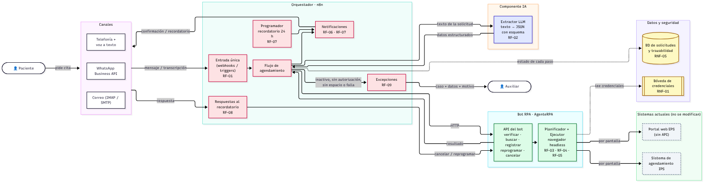
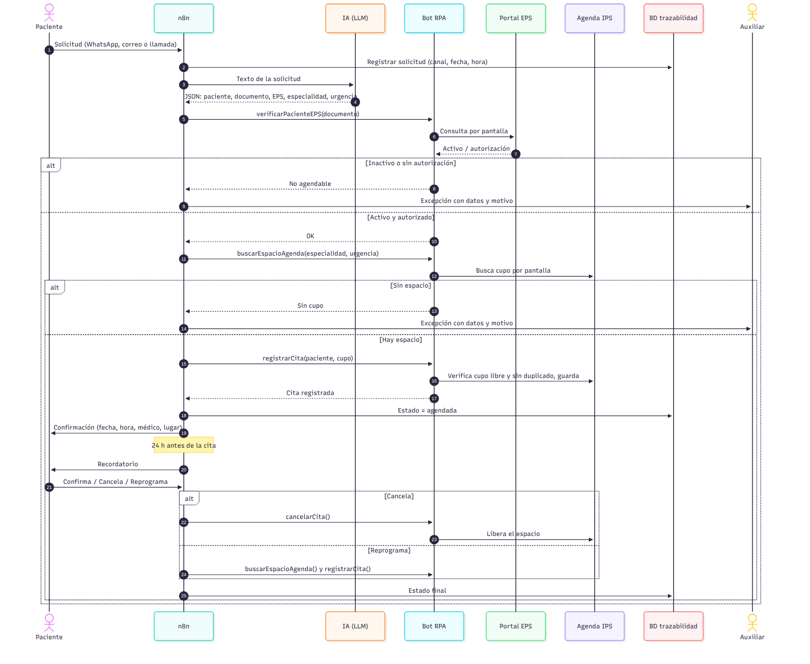

# Arquitectura de la solución – Agendamiento de citas IPS

Arquitectura de la solución que automatiza el [proceso TO-BE](../01-bpmn/tobe.svg). Cada componente sale de los [requerimientos](../04-requerimientos/requerimientos.md): n8n orquesta, la IA entiende el mensaje y el bot RPA opera el portal de la EPS y el sistema de agendamiento por pantalla, porque ninguno de los dos tiene API.

## Diagrama de componentes

> Código fuente editable en Mermaid: [arquitectura.mmd](arquitectura.mmd)

## Componentes

| Capa | Componente | Responsabilidad | Requerimientos |
|---|---|---|---|
| Canales | WhatsApp Business API, correo (IMAP/SMTP), telefonía + voz a texto | Recibir las solicitudes y devolver confirmaciones y recordatorios por el mismo canal. Las llamadas se transcriben antes de entrar al flujo. | RF-01, RF-06, RF-07 |
| Orquestador | **n8n** | Punto de entrada único, coordina IA y RPA, envía notificaciones, programa el recordatorio de 24 h, procesa las respuestas y pasa las excepciones al auxiliar. | RF-01, RF-06, RF-07, RF-08, RF-09, RNF-05 |
| IA | Extractor LLM | Convierte el mensaje libre en un JSON con esquema fijo: nombre, tipo y número de documento, EPS, especialidad y urgencia. | RF-02 |
| RPA | Bot RPA (`AgenteRPA`) | Expone una API interna que n8n llama por HTTP. Por dentro, el planificador y el ejecutor manejan un navegador headless sobre el portal de la EPS y la agenda de la IPS (ver [diagrama de clases](../06-diagrama-clases/README.md)). | RF-03, RF-04, RF-05, RF-08, RNF-03 |
| Sistemas actuales | Portal web de la EPS, sistema de agendamiento de la IPS | Se usan tal como están; la solución no los modifica. | RNF-03 |
| Datos | BD de solicitudes y trazabilidad | Guarda cada solicitud con su estado, fecha y quién actuó (IA, bot, n8n o auxiliar). | RNF-05 |
| Seguridad | Bóveda de credenciales | Guarda las credenciales del portal de la EPS y de los canales fuera del código. | RNF-01 |

## Interfaces entre componentes

| Origen → Destino | Medio | Qué viaja |
|---|---|---|
| Canales → n8n | Webhook / trigger | Mensaje o transcripción, canal, fecha y hora |
| n8n → IA | API del LLM (HTTPS) | Texto de la solicitud + esquema JSON esperado |
| IA → n8n | Respuesta JSON | Datos estructurados del paciente y la solicitud |
| n8n → Bot RPA | HTTP (API interna) | `verificarPacienteEPS`, `buscarEspacioAgenda`, `registrarCita`, `reprogramarCita`, `cancelarCita` |
| Bot RPA → Portal EPS / Agenda IPS | Interfaz web (navegador) | Clics, escritura y lectura de pantalla |
| n8n → Auxiliar | Bandeja de excepciones | Datos ya extraídos + motivo de la excepción |
| n8n → BD | SQL | Estado de cada paso de la solicitud |

## Flujo principal

> Código fuente editable en Mermaid: [secuencia.mmd](secuencia.mmd)

1. El paciente pide la cita por WhatsApp, correo o llamada. n8n la recibe y la registra.
2. n8n envía el texto a la IA, que devuelve los datos estructurados.
3. n8n le pide al bot verificar al paciente en el portal de la EPS. Si está inactivo o sin autorización, el caso pasa al auxiliar.
4. El bot busca el espacio más cercano en la agenda, dando prioridad a las urgentes. Si no hay, el caso pasa al auxiliar.
5. El bot registra la cita, verificando antes que el espacio siga libre y que no haya duplicado.
6. n8n envía la confirmación y, 24 h antes, el recordatorio.
7. Según la respuesta del paciente, la cita queda confirmada, el bot la cancela o vuelve a buscar espacio.

## Cómo se cumplen los requerimientos no funcionales

| RNF | Cómo lo resuelve la arquitectura |
|---|---|
| RNF-01 · Protección de datos | Tráfico por HTTPS, BD cifrada, credenciales en la bóveda y acceso a la bandeja de excepciones solo para personal autorizado. |
| RNF-02 · Disponibilidad | Si la IA o el bot fallan, n8n reintenta y, si sigue fallando, manda la solicitud al auxiliar como excepción; ninguna solicitud se pierde porque ya quedó registrada en la BD. |
| RNF-03 · Compatibilidad | El bot opera por pantalla; los sistemas actuales no se tocan. |
| RNF-04 · Tiempo de respuesta | El flujo completo no requiere intervención humana en el caso normal (7,3 min promedio en la simulación). n8n puede procesar varias solicitudes en paralelo. |
| RNF-05 · Trazabilidad | Cada paso escribe su estado en la BD, consultable por solicitud. |
