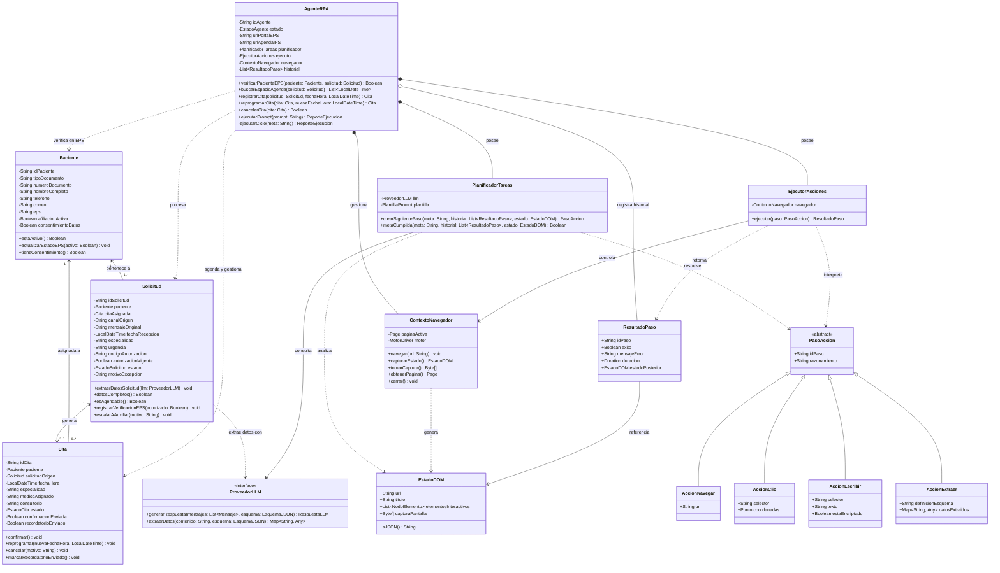

# Diagrama de clases del agente RPA – Agendamiento de citas IPS

Adaptación del diagrama de clases base del agente RPA al proceso automatizado de asignación de citas médicas en una IPS de consulta externa ([proceso TO-BE](../01-bpmn/tobe.svg)), incorporando las entidades del dominio **`Paciente`**, **`Solicitud`** y **`Cita`**.

## Diagrama de clases

> Código fuente editable en Mermaid: [diagrama-clases-rpa.mmd](diagrama-clases-rpa.mmd)

Ver código Mermaid

## Clases del dominio incorporadas

| Clase | Responsabilidad en el caso | Atributos y validaciones clave |
| --- | --- | --- |
| **`Paciente`** | Representa al usuario afiliado a una EPS que solicita atención en la IPS de consulta externa. | Identificación (`tipoDocumento`, `numeroDocumento`), canales de contacto (`telefono`, `correo`), `eps`, estado `afiliacionActiva` consultado en el portal de la EPS y `consentimientoDatos` para cumplir la **Ley 1581 de 2012**. |
| **`Solicitud`** | Modela cada requerimiento recibido por WhatsApp, correo o llamada (~300/día) y su ciclo de validación. | Almacena `canalOrigen`, `mensajeOriginal`, `especialidad`, `urgencia`, `codigoAutorizacion` y `autorizacionVigente`. Usa `ProveedorLLM` (`extraerDatosSolicitud`) para estructurar el mensaje, valida si `esAgendable()` y registra el `motivoExcepcion` cuando se escala al auxiliar. |
| **`Cita`** | Representa el espacio médico efectivamente asignado en el sistema de agendamiento de la IPS. | Vincula al `Paciente` y la `Solicitud` de origen con `fechaHora`, `especialidad`, `medicoAsignado`, `consultorio`, `estado` y banderas de trazabilidad (`confirmacionEnviada`, `recordatorioEnviado` 24 h antes) para soportar confirmación, reprogramación y cancelación. |

### Relaciones y multiplicidades del dominio

- **`Solicitud` (`1..*`) → `Paciente` (`1`) — `pertenece a`:** un paciente puede realizar múltiples solicitudes de cita a lo largo del tiempo; toda solicitud está asociada a un único paciente.
- **`Solicitud` (`1`) ↔ `Cita` (`0..1`) — `genera`:** una solicitud válida y con disponibilidad origina una cita; si el paciente está inactivo, carece de autorización o no hay cupo, la solicitud pasa a excepción sin generar cita automática (`0`).
- **`Cita` (`0..*`) → `Paciente` (`1`) — `asignada a`:** un paciente puede tener cero o varias citas registradas (históricas o futuras), cada una asignada a un único paciente.
- **`Solicitud` ⇢ `ProveedorLLM` — `extrae datos con`:** conecta la tarea de IA (*Extraer datos de la solicitud*) con el método `extraerDatos` del proveedor LLM para obtener documento, especialidad y urgencia a partir de texto no estructurado.

## Adaptación del Agente RPA al proceso TO-BE

Como ni el portal de las EPS ni el sistema de agendamiento de la IPS cuentan con API, `AgenteRPA` incorpora las direcciones objetivo (`urlPortalEPS`, `urlAgendaIPS`) y expone operaciones de dominio que encapsulan el ciclo autónomo (`ejecutarCiclo`) sobre la interfaz web:

| Operación en `AgenteRPA` | Tarea correspondiente en el BPMN TO-BE | Uso de los componentes internos del agente |
| --- | --- | --- |
| `verificarPacienteEPS(paciente, solicitud)` | *Verificar paciente en portal EPS* | Navega a `urlPortalEPS` (`AccionNavegar`), ingresa credenciales y documento con `AccionEscribir` (`estaEncriptado = true` por Ley 1581), extrae estado de afiliación y autorización (`AccionExtraer`) y actualiza `Paciente` y `Solicitud`. |
| `buscarEspacioAgenda(solicitud)` | *Buscar espacio en la agenda* | Navega a `urlAgendaIPS`, filtra por `especialidad` y `urgencia` (`AccionClic` / `AccionEscribir`) y extrae los horarios disponibles desde el `EstadoDOM` (`AccionExtraer`). |
| `registrarCita(solicitud, fechaHora)` | *Registrar cita y guardar en base de datos* | Selecciona el cupo en el sistema de agendamiento, diligencia los datos del `Paciente` sin doble digitación manual y retorna la instancia de `Cita` creada. |
| `reprogramarCita(cita, nuevaFechaHora)` | Flujo *Reprograma* tras recordatorio | Busca el nuevo cupo disponible, actualiza la reserva en `urlAgendaIPS` y sincroniza el estado de la `Cita`. |
| `cancelarCita(cita)` | *Cancelar cita y liberar espacio* | Ubica la reserva activa en `urlAgendaIPS`, ejecuta la cancelación por pantalla liberando el cupo médico y marca la `Cita` como cancelada. |
