# Solución implementada – Agendamiento de citas IPS

Implementación ejecutable del [proceso TO-BE](../01-bpmn/tobe.svg) en **n8n**, integrando la extracción estructurada con **IA (Google Gemini)** y la automatización **RPA** (con pantallas de portal EPS y agenda simuladas mediante datos de prueba) de acuerdo con los [requerimientos](../04-requerimientos/README.md), la [arquitectura](../05-arquitectura/README.md) y el [diagrama de clases](../06-diagrama-clases/README.md).

## Archivos de esta carpeta

| Archivo | Descripción |
|---|---|
| [agendamiento-citas-ips.json](agendamiento-citas-ips.json) | Flujo completo exportado de n8n listo para importar y ejecutar (`Agendamiento de citas IPS`). |
| [configuracion-extractor-ia.json](configuracion-extractor-ia.json) | Especificación del componente de IA: modelo, parámetros, *system prompt*, esquema JSON y reglas de normalización. |

## Estructura del flujo en n8n

```mermaid
flowchart LR
    T1(["Manual Trigger<br/>Probar con un ejemplo"]) --> EJ["Ejemplo de solicitud"]
    T2(["Webhook POST<br/>/solicitud-cita · RF-01"]) --> CFG["Configuración"]
    EJ --> CFG
    CFG --> REG["Registrar solicitud<br/>RF-01 · RNF-05"]
    REG --> IA["Extraer datos (IA)<br/>RF-02"]
    GEM[["Google Gemini<br/>gemini-2.5-flash"]] -.-> IA
    IA -->|"éxito"| UNIR["Unir datos extraídos<br/>RF-02"]
    IA -->|"error tras 3 intentos"| EXC["Pasar excepción al auxiliar<br/>RF-09 · RNF-02"]
    UNIR --> EPS["Verificar paciente en portal EPS (RPA)<br/>RF-03"]
    EPS --> GW1{"¿Activo y<br/>autorizado?"}
    GW1 -->|"No"| EXC
    GW1 -->|"Sí"| BUS["Buscar espacio en la agenda (RPA)<br/>RF-04"]
    BUS --> GW2{"¿Hay espacio?"}
    GW2 -->|"No"| EXC
    GW2 -->|"Sí"| CIT["Registrar cita (RPA)<br/>RF-05"]
    CIT --> CONF["Enviar confirmación<br/>RF-06"]
    CONF --> W24["Esperar hasta 24 h antes<br/>(10 s en modo demo)"]
    W24 --> REC["Enviar recordatorio<br/>RF-07"]
    REC --> WRESP["Esperar respuesta del paciente<br/>Webhook GET · RF-08"]
    WRESP --> LEER["Leer respuesta"]
    LEER --> SW{"¿Qué responde?"}
    SW -->|"Confirma / Sin respuesta"| OK["Cita confirmada<br/>RF-08"]
    SW -->|"Cancela"| CAN["Cancelar cita y liberar espacio (RPA)<br/>RF-08"]
    SW -->|"Reprograma"| REP["Reprogramar<br/>RF-08"]
    REP --> BUS
    OK --> DB[("Guardar trazabilidad<br/>RNF-05")]
    CAN --> DB
    EXC --> DB
```



### Detalle de nodos por requerimiento

| Nodo en n8n | Tipo de nodo | Requerimientos | Función dentro del flujo |
|---|---|---|---|
| `Recibir solicitud` | `webhook` (`POST /solicitud-cita`) | RF-01 | Punto único de entrada para solicitudes provenientes de WhatsApp, correo o llamada transcrita. |
| `Probar con un ejemplo` / `Ejemplo de solicitud` | `manualTrigger` + `set` | RF-01 | Permite ejecutar pruebas rápidas desde el editor de n8n modificando el mensaje de entrada. |
| `Configuración` | `set` | — | Define `modo_demo = true` (reduce la espera de 24 h a 10 s) y `nombre_ips = "IPS Salud Integral"`. |
| `Registrar solicitud` | `code` | RF-01, RNF-05 | Asigna `idSolicitud`, registra canal, fecha/hora ISO e inicializa la bitácora `historial`. |
| `Extraer datos (IA)` + `Google Gemini` | `informationExtractor` + `lmChatGoogleGemini` | RF-02, RNF-02 | Extrae los campos estructurados del mensaje con `gemini-2.5-flash` (`temperature = 0`), hasta 3 reintentos y salida de error hacia el auxiliar. |
| `Unir datos extraídos` | `code` | RF-02 | Limpia tildes, deja solo dígitos en `numeroDocumento`, aplica valores por defecto (`CC`, `medicina general`, `normal`) y consolida el objeto de la solicitud. |
| `Verificar paciente en portal EPS (RPA)` | `code` (RPA simulado) | RF-03, RNF-03 | Simula la consulta por pantalla en el portal de la EPS validando afiliación activa y autorización vigente según la especialidad. |
| `¿Activo y autorizado?` | `if` | RF-03, RF-09 | Continúa al agendamiento si `afiliacionActiva && autorizacionVigente`; de lo contrario escala al auxiliar. |
| `Buscar espacio en la agenda (RPA)` | `code` (RPA simulado) | RF-04, RNF-03 | Busca el cupo más próximo en los siguientes 5 días hábiles, reservando el primer cupo para urgencia `alta` y filtrando posteriores a `citaAnterior` al reprogramar. |
| `¿Hay espacio?` | `if` | RF-04, RF-09 | Si existe disponibilidad avanza al registro; si no hay agenda, escala el caso al auxiliar. |
| `Registrar cita (RPA)` | `code` (RPA simulado) | RF-05, RF-08 | Genera la cita (`CITA-<documento>-<fechaHora>`), evita duplicados y libera el cupo previo en caso de reprogramación. |
| `Enviar confirmación` | `code` | RF-06 | Construye y registra el envío de la confirmación inmediata por el mismo `canalOrigen` con fecha, hora, médico, consultorio y código. |
| `Esperar hasta 24 h antes` | `wait` | RF-07 | Espera hasta 24 h antes de la cita (`10 s` cuando `modo_demo = true`). |
| `Enviar recordatorio` | `code` | RF-07 | Envía el recordatorio con opciones `CONFIRMO`, `CANCELO` o `REPROGRAMO` y genera enlaces interactivos con `$execution.resumeUrl`. |
| `Esperar respuesta del paciente` + `Leer respuesta` | `wait` (webhook) + `code` | RF-08 | Espera la respuesta del paciente hasta por 23 horas; si vence el plazo, marca `sin respuesta`. |
| `¿Qué responde?` | `switch` | RF-08 | Enruta según la respuesta: `Confirma`, `Cancela`, `Reprograma` o salida por defecto `Sin respuesta`. |
| `Cita confirmada` | `code` | RF-08 | Marca la cita como `Confirmada` (o `Agendada sin respuesta` si no contestó). |
| `Cancelar cita y liberar espacio (RPA)` | `code` (RPA simulado) | RF-08 | Cancela la cita y libera el cupo médico en la agenda. |
| `Reprogramar` | `code` | RF-08 | Guarda `citaAnterior` y retorna al nodo `Buscar espacio en la agenda (RPA)` para asignar el siguiente cupo libre. |
| `Pasar excepción al auxiliar` | `code` | RF-09, RNF-02 | Entrega el caso a la bandeja del auxiliar con los datos ya extraídos y el `motivoExcepcion` (negocio o falla técnica). |
| `Guardar trazabilidad` | `code` (BD simulada) | RNF-05 | Persiste el estado final de la solicitud, los datos de la cita y el arreglo completo `historial` con fecha, paso y actor. |

## Componente de IA (RF-02)

La extracción semántica se ejecuta con el nodo **Information Extractor** de LangChain en n8n conectado a **Google Gemini** (`models/gemini-2.5-flash`, `temperature: 0`). Las credenciales se almacenan en el gestor cifrado de credenciales de n8n (cumpliendo **RNF-01**), y el nodo cuenta con `retryOnFail = true` (`maxTries = 3`, espera de `3000 ms`) y `onError = continueErrorOutput` hacia `Pasar excepción al auxiliar` (cumpliendo **RNF-02**).

### System prompt

```text
Eres el asistente de agendamiento de una IPS en Colombia. Extrae solo la información que aparece en el mensaje del paciente. Si un dato no aparece, deja el campo vacío.
```

### Esquema de atributos y normalización

| Campo | Instrucción al modelo (`Extraer datos (IA)`) | Regla de normalización (`Unir datos extraídos`) |
|---|---|---|
| `nombreCompleto` | Nombre completo del paciente | Cadena vacía `""` si no se menciona (se completa al consultar la EPS si existe). |
| `tipoDocumento` | Tipo de documento: `CC`, `TI`, `CE` o `PA`. Si dice cédula, es `CC` | Por defecto `"CC"` si llega vacío. |
| `numeroDocumento` | Número de documento del paciente, solo dígitos | Elimina cualquier carácter no numérico (`replace(/\D/g, '')`). |
| `eps` | EPS del paciente, si la menciona | Se conserva el texto extraído o se completa con la EPS registrada en el portal. |
| `especialidad` | Una de: `medicina general`, `odontologia`, `pediatria`, `dermatologia`, `cardiologia`. Si no la dice, `medicina general` | Remueve tildes (`NFD`), convierte a minúsculas y asigna `"medicina general"` por defecto. |
| `urgencia` | `alta` si dice que es urgente o describe síntomas graves; si no, `normal` | `"alta"` únicamente cuando el valor normalizado coincide con `"alta"`; en otro caso `"normal"`. |

> Los resultados detallados de validación del prompt sobre mensajes reales de WhatsApp, correo y llamadas transcritas se encuentran en [08-chats-prueba](../08-chats-prueba/README.md).

## Componente Bot RPA – Pantallas simuladas vs. producción (RF-03, RF-04, RF-05, RF-08)

Dado que el portal web de la EPS y el sistema legado de agendamiento de la IPS no existen en el entorno académico de demostración, los cuatro pasos de RPA dentro del flujo n8n simulan la lectura y escritura por pantalla con conjuntos de datos controlados. En producción, cada uno de estos nodos invoca por HTTP la operación homónima de `AgenteRPA` definida en la [arquitectura](../05-arquitectura/README.md) y el [diagrama de clases](../06-diagrama-clases/README.md):

| Nodo en el flujo n8n | Operación en `AgenteRPA` | Comportamiento simulado / en pantalla |
|---|---|---|
| `Verificar paciente en portal EPS (RPA)` | `verificarPacienteEPS(paciente, solicitud)` | Consulta el documento en el portal EPS, verifica afiliación activa y exige autorización vigente para `dermatologia` y `cardiologia`. Si aplica, genera `AUT-<documento>`. |
| `Buscar espacio en la agenda (RPA)` | `buscarEspacioAgenda(solicitud)` | Genera los horarios hábiles (lunes a viernes) de los próximos 5 días para la especialidad. Reserva el primer cupo libre exclusivamente para solicitudes con `urgencia = "alta"`. |
| `Registrar cita (RPA)` | `registrarCita` / `reprogramarCita` | Registra la cita con código `CITA-<documento>-<fechaHora>`. Cuando proviene de reprogramación (`citaAnterior`), mueve la cita al nuevo horario y deja trazabilidad del cupo liberado. |
| `Cancelar cita y liberar espacio (RPA)` | `cancelarCita(cita)` | Cambia el estado de la cita a `Cancelada` y registra la liberación del cupo en la agenda. |

### Pacientes de prueba configurados (Portal EPS simulado)

| Documento | Paciente | EPS | Estado | Autorizaciones vigentes | Escenario que permite probar |
|---|---|---|---|---|---|
| `1037654321` | Ana Gómez | Sura | Activo | `dermatologia` | Flujo exitoso completo (medicina general, odontología, pediatría o dermatología). |
| `43210987` | Luisa Pérez | Sanitas | Activo | Ninguna | Excepción RF-03/RF-09 al pedir `dermatologia` o `cardiologia` (*sin autorización*). |
| `98765432` | Carlos Ruiz | Nueva EPS | Activo | `cardiologia` | Excepción RF-04/RF-09 al pedir `cardiologia` (*autorizado, pero sin agenda disponible*). |
| `11223344` | Pedro Díaz | Sura | Inactivo | Ninguna | Excepción RF-03/RF-09 (*paciente inactivo en la EPS*). |

### Agenda médica configurada (Sistema IPS simulado)

| Especialidad | Médico asignado | Consultorio | Horas hábiles diarias | Disponibilidad |
|---|---|---|---|---|
| `medicina general` | Dra. Laura Mejía | Consultorio 101 | 07:00, 08:00, 09:00, 14:00, 15:00 | Con cupos |
| `odontologia` | Dr. Felipe Mora | Consultorio 204 | 08:00, 11:00 | Con cupos |
| `pediatria` | Dra. Sara Ríos | Consultorio 110 | 09:00, 16:00 | Con cupos |
| `dermatologia` | Dr. Juan Ochoa | Consultorio 302 | 10:00 | Con cupos (requiere autorización EPS) |
| `cardiologia` | Dr. Andrés Gil | Consultorio 305 | *(sin horarios)* | Sin cupos en los próximos 5 días hábiles |

## Cómo importar y probar el flujo

1. **Importar el flujo en n8n:** abrir n8n, seleccionar **Workflows → Import from File** y cargar [`agendamiento-citas-ips.json`](agendamiento-citas-ips.json).
2. **Configurar la credencial de IA:** abrir el nodo **Google Gemini**, crear una credencial de *Google Gemini (PaLM) Api* y pegar la API Key generada en Google AI Studio.
3. **Ejecutar desde el disparador manual:**
   - Hacer clic en **Execute workflow** (inicia por `Probar con un ejemplo` → `Ejemplo de solicitud`).
   - Tras agendar y enviar la confirmación, el nodo `Esperar hasta 24 h antes` aguardará **10 segundos** (`modo_demo = true`) y ejecutará `Enviar recordatorio`.
4. **Simular la respuesta del paciente al recordatorio (RF-08):**
   - Inspeccionar la salida JSON del nodo `Enviar recordatorio` y abrir en el navegador cualquiera de los tres enlaces del objeto `responderDemo`:
     - `responderDemo.confirma` (`?respuesta=confirma`) → marca la cita como `Confirmada`.
     - `responderDemo.cancela` (`?respuesta=cancela`) → cancela la cita y libera el espacio en la agenda.
     - `responderDemo.reprograma` (`?respuesta=reprograma`) → vuelve a `Buscar espacio en la agenda (RPA)`, asigna el siguiente horario posterior y libera el anterior.
5. **Probar por Webhook (opcional, RF-01):** con el flujo en escucha o activo, enviar una petición `POST` al endpoint `/webhook-test/solicitud-cita` (o `/webhook/solicitud-cita`):

```bash
curl -X POST http://localhost:5678/webhook-test/solicitud-cita \
  -H "Content-Type: application/json" \
  -d '{
    "canal": "WhatsApp",
    "telefono": "3001234567",
    "correo": "",
    "mensaje": "Hola, buenas tardes. Soy Ana Gómez, cédula 1037654321, de Sura. Necesito una cita de medicina general, es urgente porque tengo fiebre hace 3 días."
  }'
```
