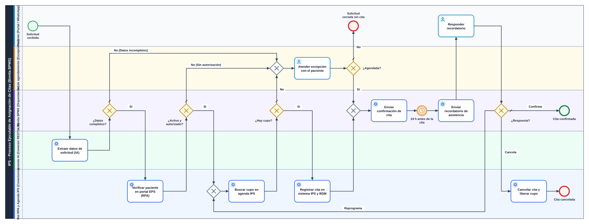
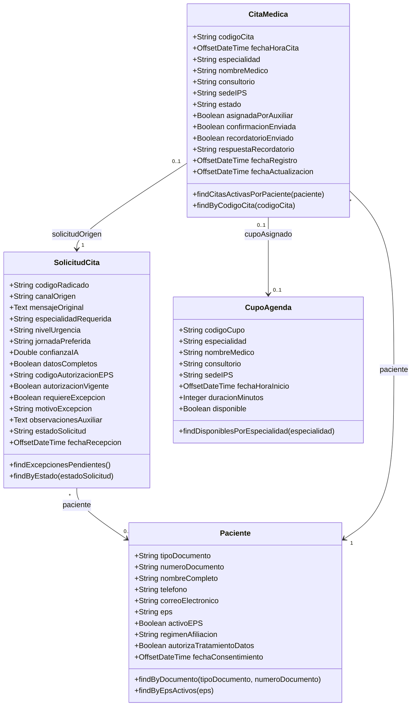

# Modelado Ejecutable en Bonita Studio (BPMS)

Esta carpeta contiene el diseño arquitectónico y los artefactos técnicos listos para importar en **Bonita Studio Community Edition** para automatizar el proceso de asignación, confirmación, recordatorio, reprogramación y cancelación de citas médicas de la IPS.

---

## 1. Diagrama BPMN 2.0 Ejecutable para Bonita

### Mejoras de Ingeniería respecto al modelo conceptual (`01-bpmn/tobe`)
Para convertir el diagrama conceptual en un proceso **100 % ejecutable en un motor BPMS** cumpliendo las buenas prácticas de modelado (Dumas et al. / estándar BPMN 2.0):

1. **Tipado estricto de tareas BPMN 2.0 (`isExecutable="true"`):**
   * **User Tasks (`bpmn:userTask`):** `Atender excepción con el paciente` (bandeja de los 4 auxiliares) y `Responder recordatorio` (interacción del paciente vía Portal o Bonita REST API).
   * **Service Tasks (`bpmn:serviceTask`):** Extracción con IA, verificación RPA en portal EPS, búsqueda/registro/liberación de cupos en agenda IPS y envío de notificaciones.
2. **Evento Intermedio Temporizador real (`Timer_24hAntes`):**
   * Se incorporó un `IntermediateCatchEvent` (`timerEventDefinition`) entre el envío de la confirmación inicial y el envío del recordatorio, calculado dinámicamente como `fechaHoraCita - 24 horas`.
3. **Compuerta de calidad de extracción IA (`¿Datos completos?`):**
   * Evalúa `datosCompletos == true && confianzaIA >= 0.80` antes de disparar el Bot RPA contra el portal de la EPS, evitando ejecuciones fallidas de RPA con documentos incompletos.
4. **Reintegración de excepciones resueltas (`¿Agendada?` -> Confirmación):**
   * Cuando un auxiliar logra agendar manualmente un caso excepcional, el flujo converge hacia `Enviar confirmación de cita`, garantizando que esos pacientes **también reciban confirmación y recordatorio automático 24 h antes**.
5. **Compuertas explícitas de convergencia (XOR-Join):**
   * Cada actividad tiene exactamente una transición de entrada y una de salida, empleando compuertas exclusivas explícitas para las fusiones de flujo.
6. **Cumplimiento normativo (Ley 1581 de 2012):**
   * Validación obligatoria de consentimiento de tratamiento de datos sensibles de salud desde el Contrato de Instanciación y registro de estampa de tiempo en el BDM.

---

## 2. Modelo de Datos de Negocio (BDM – `bdm/bom.xml`)

El esquema relacional gestionado por Hibernate/JPA dentro de Bonita (`co.edu.eafit.ips.model`) consta de 4 entidades de negocio con restricciones de unicidad, índices y consultas JPQL personalizadas:

---

## 3. Estructura de Archivos del Paquete

| Ruta | Descripción |
| :--- | :--- |
| [`bpmn/agendamiento-citas-bonita.bpmn`](bpmn/agendamiento-citas-bonita.bpmn) | Proceso BPMN 2.0 ejecutable listo para importar en Bonita Studio (`File > Import > BPMN 2.0`). |
| [`bpmn/agendamiento-citas-bonita.svg`](bpmn/agendamiento-citas-bonita.svg) | Renderizado vectorial con iconografía estándar de tareas humanas, tareas de servicio y temporizadores. |
| [`bdm/bom.xml`](bdm/bom.xml) | Definición XML fuente del Business Data Model (`bdm-xml-schema/1.0`). |
| [`bdm/bdm.zip`](bdm/bdm.zip) | Paquete comprimido listo para importar directamente en Bonita (`Development > Business Data Model > Import`). |
| [`organizacion/IPS-Organizacion.xml`](organizacion/IPS-Organizacion.xml) | Organización de la IPS (grupos, roles, coordinador, los **4 auxiliares de agendamiento**, cuenta API y paciente demo). |
| [`contratos-y-formularios/contratos-proceso-y-tareas.json`](contratos-y-formularios/contratos-proceso-y-tareas.json) | Especificación técnica de variables BDM, contratos, reglas de validación y payload de prueba REST API. |
| [`contratos-y-formularios/especificacion-ui-designer.md`](contratos-y-formularios/especificacion-ui-designer.md) | Diseño de widgets y bindings para los 3 formularios en Bonita UI Designer. |
| [`scripts-groovy/`](scripts-groovy/) | 5 módulos Groovy con la inicialización BDM, conectores REST (IA y RPA), condiciones de gateways y operaciones de agenda. |

---

## 4. Guía Paso a Paso para Importar y Ejecutar en Bonita Studio

Cuando abras **Bonita Studio Community (2023.x / 2024.x con JDK 17)** en cualquier equipo del grupo:

1. **Importar la Organización de la IPS:**
   * Ve a `Organization > Import...` y selecciona [`organizacion/IPS-Organizacion.xml`](organizacion/IPS-Organizacion.xml).
   * Haz clic en `Organization > Deploy...` y define como usuario predeterminado de pruebas a `auxiliar1.ips` (contraseña: `bpm`).
2. **Importar el Modelo de Datos de Negocio (BDM):**
   * Ve a `Development > Business Data Model > Import...` y selecciona [`bdm/bdm.zip`](bdm/bdm.zip).
   * Haz clic en `Deploy` cuando Bonita confirme la carga de las entidades `Paciente`, `SolicitudCita`, `CupoAgenda` y `CitaMedica`.
3. **Importar el Diagrama BPMN 2.0:**
   * Ve a `File > Import > BPMN 2.0 (.bpmn)...` y elige [`bpmn/agendamiento-citas-bonita.bpmn`](bpmn/agendamiento-citas-bonita.bpmn).
4. **Mapear Actores (Actor Mapping):**
   * Selecciona el Pool -> `Configuration > Actor mapping`:
     * Lane `Auxiliar de agendamiento` -> Grupo `/ips_consulta_externa/central_citas` con Rol `auxiliar_agendamiento`.
     * Lane `Paciente` -> Grupo `/ips_consulta_externa/portal_pacientes` con Roles `paciente` e `integracion_api`.
5. **Declarar Variables, Contratos y Scripts Groovy:**
   * Declara las variables BDM (`solicitudCita`, `citaMedica`, `cupoSeleccionado`) y variables de proceso según [`contratos-proceso-y-tareas.json`](contratos-y-formularios/contratos-proceso-y-tareas.json).
   * Copia los scripts correspondientes desde [`scripts-groovy/`](scripts-groovy/) en las operaciones de cada tarea y transiciones de las compuertas.
6. **Configurar Conectores REST y Ejecutar (`Run`):**
   * En `Task_IA`, `Task_VerificarEPS`, `Task_Confirmar` y `Task_Recordatorio`, agrega un conector `REST -> POST` apuntando a los webhooks de tu orquestador / n8n / servicio mock.
   * Presiona el botón **Run** en la barra superior de Bonita Studio para desplegar el proceso y abrir el Portal Web.
