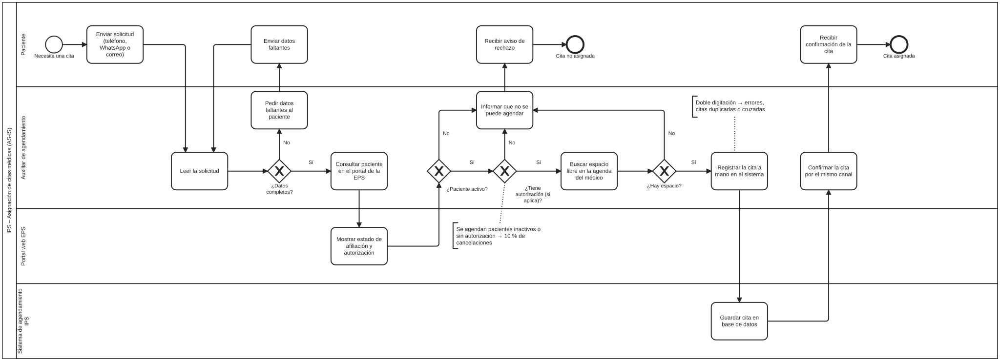
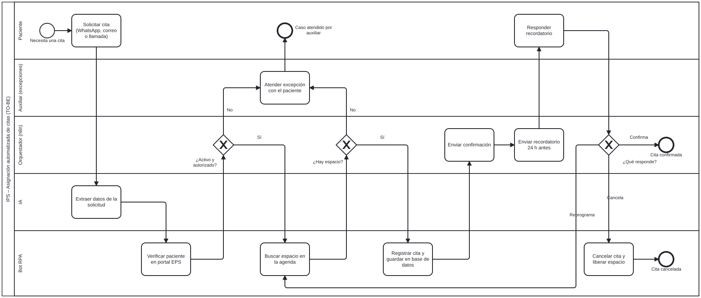

# Automatización de la asignación de citas médicas en una IPS

Proyecto del curso Automatización De Procesos De Negocios – EAFIT

## Integrantes

- Hever Andre Alfonso Jimenez – [Hever-Alfonso](https://github.com/Hever-Alfonso)
- Tomás Ramírez Galeano – [unbot2313](https://github.com/unbot2313)
- Jerónimo Restrepo – [jrestrepoc](https://github.com/jrestrepoc)
- Santiago Ramírez – [Sramirezr](https://github.com/Sramirezr)
- David Curelop – [DavidCurelop](https://github.com/DavidCurelop)

## Problemática

Una IPS de consulta externa atiende pacientes de varias EPS. Recibe unas 300 solicitudes de cita al día por WhatsApp, correo y llamadas, y 4 auxiliares las atienden a mano: 8 minutos por solicitud, o sea 40 horas de trabajo diarias frente a 32 disponibles. Por eso:

- Las solicitudes se represan y el paciente espera uno o dos días.
- Los datos se digitan varias veces y hay citas duplicadas o cruzadas.
- Se agendan pacientes inactivos o sin autorización (10 % de cancelaciones).
- Como no se envía recordatorio, hay 20 % de inasistencia.

## Restricciones

- Los datos de salud están protegidos por la Ley 1581 de 2012.
- El servicio debe estar disponible en todo el horario de atención.
- El portal de la EPS no tiene API, y la IPS no puede cambiarlo ni reemplazar su sistema de agendamiento.

## Solución propuesta

| Componente | Qué hace |
| --- | --- |
| IA | Lee la solicitud y extrae los datos del paciente, la especialidad y la urgencia. |
| RPA | Consulta el portal de la EPS por pantalla, busca espacio en la agenda y registra la cita. |
| Orquestador (n8n) | Coordina el flujo, envía la confirmación y el recordatorio 24 h antes, y pasa al auxiliar solo las excepciones. |

**Alcance:** incluye solicitar, verificar, asignar, confirmar, recordar, reprogramar y cancelar citas. No incluye atención médica, facturación ni historia clínica.

## Procesos

### AS-IS

### TO-BE

## Resultados

- **Simulación en BIMP (300 solicitudes):** el tiempo de ciclo promedio baja de 3,3 h a 7,3 min, el tiempo de espera de 1,6 h a 1,4 min y la ocupación de los auxiliares de 97 % a 27 %.
- **Caso de negocio a 3 años:** recuperación de la inversión en el mes 9, VPN de 345,5 millones de pesos y TIR de 331 %.

## Contenido del repositorio

| Carpeta | Contenido |
| --- | --- |
| [01-bpmn](01-bpmn/) | Modelos AS-IS y TO-BE |
| [02-simulacion](02-simulacion/) | Resultados de BIMP y heatmaps |
| [03-caso-negocio](03-caso-negocio/) | Caso de negocio en Excel |
| [04-requerimientos](04-requerimientos/) | Requerimientos funcionales y no funcionales |
| 05-arquitectura | Diagrama de arquitectura (en progreso) |
| 06-diagrama-clases | Diagrama de clases (en progreso) |
| 07-solucion | Flujo n8n, bot RPA y componente de IA (pendiente) |
| 08-chats-prueba | Chats de prueba del componente de IA (pendiente) |

## Backlog

El seguimiento del trabajo está en la pestaña **Projects** de este repositorio: [tablero del proyecto](https://github.com/users/Hever-Alfonso/projects/8).
